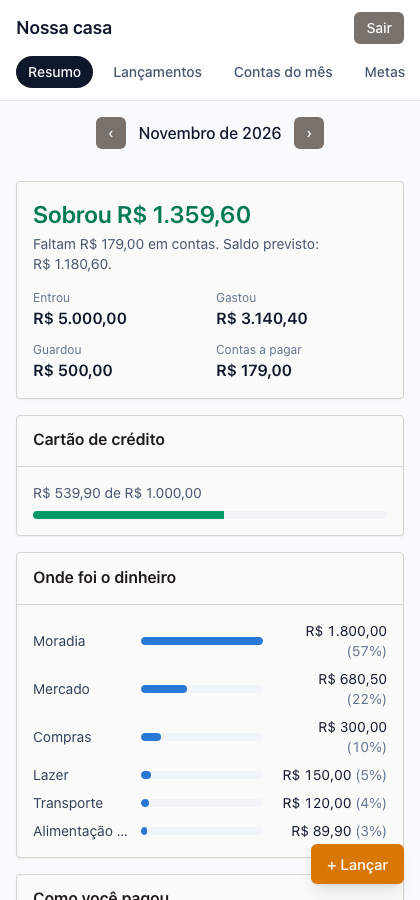
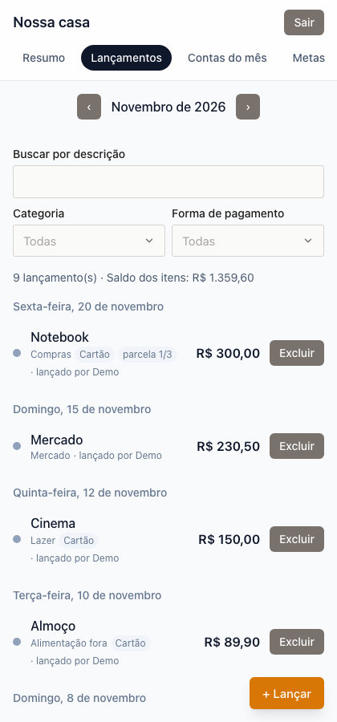
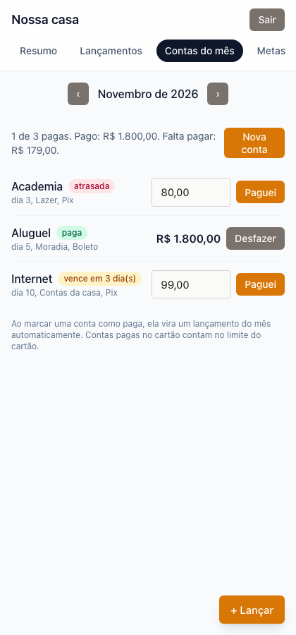
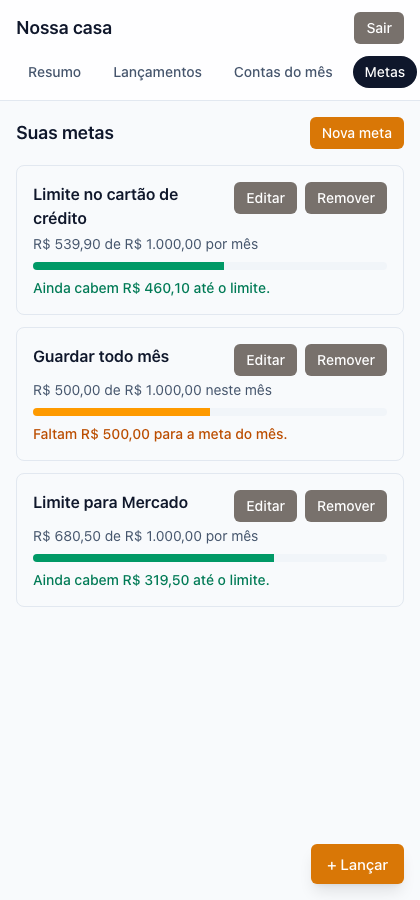
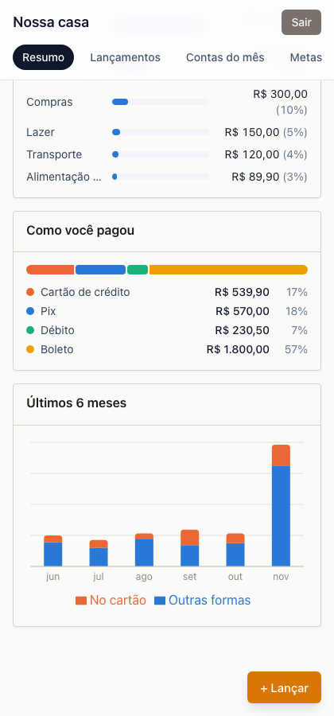

# Aonde vai o meu dinheiro

App web de controle financeiro pessoal, feito para uma casa (dois usuários)
compartilharem lançamentos, contas recorrentes, parcelamentos no cartão,
metas e um resumo mensal com gráficos. Substitui uma planilha de Google
Sheets.

> ⚠️ Repositório público. Os dados de cada casa são privados — veja
> [SECURITY.md](./SECURITY.md) para reportar problemas de segurança.

## Status

Funcionalidades principais implementadas: login, lançamentos, parcelamento
no cartão, contas recorrentes, metas, resumo com gráficos, lixeira, PWA,
deploy e backup. Pendente: testes e2e (Playwright) — veja a nota em
[CLAUDE.md](./CLAUDE.md#pendência-testes-e2e-decisão-de-2026-11-07).

## Capturas de tela

Dados fictícios, gerados num Supabase local só para este propósito —
nenhum dado real aparece aqui.

| Resumo do mês                              | Lançamentos                                   |
| ------------------------------------------ | --------------------------------------------- |
|  |  |

| Contas do mês                              | Metas                             |
| ------------------------------------------ | --------------------------------- |
|  |  |

Gráfico dos últimos 6 meses (parte do Resumo):



## Funcionalidades

- **Lançamentos**: gastos e entradas, com busca e filtros por categoria e
  forma de pagamento, agrupados por dia.
- **Parcelamento no cartão**: compra parcelada (2–24x) cria as parcelas
  automaticamente, numa operação atômica no banco.
- **Contas recorrentes**: cadastro, valor variável com estimativa pelo
  histórico, status de vencimento, pagar/desfazer.
- **Metas**: limite no cartão, limite por categoria, guardar por mês — com
  barra de progresso colorida.
- **Resumo do mês**: saldo, gastos por categoria e por forma de pagamento,
  contas pendentes, saldo previsto, gráfico dos últimos 6 meses.
- **Lixeira**: nada é apagado de verdade — lançamentos excluídos podem ser
  restaurados.
- **Backup**: exporta tudo da casa em JSON + CSV, com backup diário
  automático (repositório privado separado) e procedimento de restauração
  documentado.
- **PWA**: instalável no celular.

## Stack

Vite, React, TypeScript, React Router, TanStack Query, Zod, Tailwind CSS,
`@single-ui/react`, Recharts, Supabase (Postgres, Auth), Vitest, Testing
Library, fast-check, pgTAP, Playwright (instalado, suíte pendente).
Hospedagem na Vercel.

## Como rodar localmente

Este projeto desenvolve **direto contra o projeto Supabase remoto** (sem
banco local de desenvolvimento — veja
[CLAUDE.md](./CLAUDE.md#fluxo-de-banco-de-dados-decisão-de-2026-11-06)).
Docker só é usado pontualmente, para rodar os testes de banco.

```bash
npm install
cp .env.example .env.local   # preencha com a URL e a publishable key do seu projeto Supabase
npm run dev
```

Setup completo do Supabase (criar projeto, usuários, etc.) em
[docs/supabase-setup.md](./docs/supabase-setup.md).

### Scripts disponíveis

| Comando                 | O que faz                                   |
| ----------------------- | ------------------------------------------- |
| `npm run dev`           | Ambiente de desenvolvimento                 |
| `npm run build`         | Build de produção                           |
| `npm run lint`          | ESLint                                      |
| `npm run format`        | Prettier                                    |
| `npm run typecheck`     | Checagem de tipos                           |
| `npm test`              | Testes unitários (Vitest)                   |
| `npm run test:coverage` | Testes unitários com cobertura              |
| `npm run test:db`       | Testes pgTAP do banco (Docker efêmero)      |
| `npm run import-backup` | Importa um backup exportado num banco local |

Mais detalhes de arquitetura, regras de negócio e decisões de projeto estão
em [CLAUDE.md](./CLAUDE.md). Deploy em [docs/deploy.md](./docs/deploy.md),
backup/restauração em [docs/restore.md](./docs/restore.md).

## Licença

[MIT](./LICENSE).
